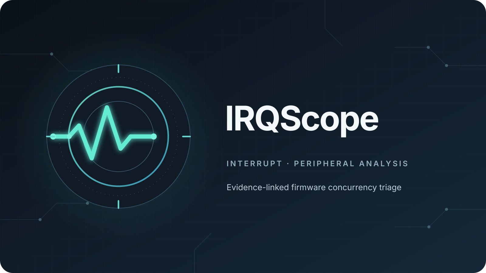

# IRQScope

[](https://github.com/shobhit1kapoor/irqscope/actions/workflows/validation.yml)



See [CHANGELOG.md](CHANGELOG.md) for the current prototype release notes.

**Find the interrupt interleavings that can corrupt a hardware operation.**

IRQScope is an IDA Pro firmware-analysis workbench being built to discover and explain concurrency hazards between foreground code, interrupt handlers, and memory-mapped peripherals. Its full design reconstructs execution contexts, models register semantics, and builds evidence-linked interleaving witnesses for an analyst to review.

> **Prototype status:** local SVD import, vector-table candidate review, bounded constant/constant-index MMIO recovery, recognized Cortex-M mask snapshots, review-only transaction sequence proposals, analyst-authored transaction contracts, conservative cross-context candidate rules, and JSON export are implemented. This is not yet a validated vulnerability detector or contest-ready release. See [known limits](docs/roadmap.md#current-prototype-limits).

## The problem

Firmware can use a peripheral as a multi-step protocol: wait for ready, select a channel, transfer data, acknowledge status, or hand a buffer to DMA. An interrupt can arrive between steps and alter the peripheral or shared software state. Reviewing functions one at a time hides the interleaving that makes the failure possible.

IRQScope treats this as a concurrency question. For each candidate operation it asks: which interrupt contexts can run in the middle of it; do their register or buffer effects commute with the operation; and what are the concrete paths and assumptions behind the answer?

## Candidate interleaving evidence

The current prototype links each candidate to the observed foreground and handler accesses, a shortest recovered CFG path to a later same-peripheral foreground access, and a single-event insertion sketch:

```text
Foreground: read STATUS.READY == 1
Foreground: write CONTROL.START = 1
                 ↓ candidate interrupt insertion (preemption unresolved)
ISR:        read STATUS       [read-to-clear, from SVD]
ISR:        write DATA        [same peripheral transaction]
Foreground: read DATA        [continues under the assumption READY stayed true]

Illustrative concern: the ISR's status read may clear a condition before the
foreground consumes DATA. Whether this schedule occurs depends on interrupt
configuration, recovered paths, and imported register semantics.
```

Selecting a candidate updates its evidence panel; address links in the panel and MMIO access rows navigate to IDA addresses. The current evidence contains the available vector mapping, mask snapshots, register description, and basic-block path. IRQ enable state and most path predicates are not recovered. When SVD provides `nvicPrioBits` and a static CMSIS priority callsite is available, the evidence may include a conditional BASEPRI comparison; this does not establish effective runtime priority. Constant CBZ/CBNZ are filtered. Adjacent CMP/CMN and supported ADDS/SUBS resolve EQ/NE, MI/PL, VS/VC, CS/HS, CC/LO, HI/LS, and signed GE/LT/GT/LE conditions when operands are known; TST/TEQ resolve EQ/NE and MI/PL. Supported constant shifted-register operands use the same bounded resolver as MMIO address propagation. Predicated compares, Thumb IT blocks, carry-dependent RRX forms, other predicates, and unknown operands remain unresolved. The sequence-mining tab proposes short CFG-reachable MMIO chains for review; transaction findings still require an analyst-supplied contract, so the dashboard states assumptions instead of presenting a verified trace.

## Product surfaces

1. **Device Map** — the prototype shows imported SVD registers and recovered accesses, including shared-address aliases and explicit alternate peripheral, cluster, and register relationships. Address-region authoring and unresolved-address review remain planned.
2. **Execution Model** — the prototype reviews vector mappings, recognized global mask snapshots, and static NVIC enable/disable/priority API callsites with constant IRQ arguments. Conflicting mask states at CFG joins are downgraded to unknown and surfaced as analysis warnings. Runtime call reachability and effective enable state remain unresolved; the BASEPRI priority hint is explicitly conditional.
3. **Transaction Lab** — import analyst-authored transaction contracts to match CFG-reachable foreground event sequences against either any declared ISR event or an ordered ISR interference sequence, including different-register interactions.
4. **Sequence Mining** — inspect bounded foreground MMIO chains with CFG path evidence, including loop-back and repeated-instruction candidates, repeated-pattern support, and SVD side-effect cues such as read actions and modified-write behavior. Semantic cues rank ahead of pattern-only candidates when the output bound is reached. Record an open/confirmed/dismissed review and note for each proposal; the review persists in the IDB and evidence export. Save a selected chain as an editable protocol-contract draft populated with observed same-peripheral handler events, then import the draft to validate it against the SVD. Proposals and drafts remain review leads, not inferred protocol truth.
5. **Evidence Ledger** — set an open/confirmed/dismissed verdict and analyst note per finding; reviews persist in the IDB and travel with JSON exports. Assumption-level triage remains planned.

The current UI includes a dark, dockable IDA dashboard with device/access/finding counters, filterable and sortable evidence tables, linked evidence view, device register map with reset field encodings when all bits are known, declared write constraints, alternate peripheral/cluster/register relationships, MMIO access index with per-write constraint results, interrupt setup callsite table, and sequence mining with navigable paths, review notes, and editable protocol drafts. Sorting treats addresses and counts numerically, ranks finding severities, and preserves finding/proposal identity for review, navigation, and note persistence. Long analysis passes show progress and accept cancellation; cancelled reruns keep the last completed results, and a cancelled protocol import is rolled back. Import a protocol JSON contract after the SVD to include transaction-level candidates in analysis. Double-clicking a callsite, MMIO access, or sequence proposal, or choosing an address link, navigates to that address in IDA. The older chooser tables remain available for vector review and focused result views.

## Current prototype and intended first release

The contest-sized core targets Cortex-M firmware and prioritizes transparent results over broad processor coverage. The prototype currently provides:

- Import CMSIS-SVD register names, widths, access permissions, inherited reset values and known-bit masks, CPU endianness, byte address units, NVIC priority-bit count, `readAction`, `modifiedWriteValues`, and declared range/enum/write-as-read constraints; resolve peripheral, cluster, register, field, and named enumerated-value-set inheritance; expand peripheral, cluster, register, and field arrays; preserve multiple SVD register descriptions at a shared address as explicit aliases; retain and display validated `alternatePeripheral`, `alternateCluster`, and `alternateRegister` links.
- Rank plausible Cortex-M vector tables and let the analyst select one; map vector slots to existing IDA functions.
- Index exact absolute-memory operands, constant-base-plus-displacement dereferences, and constant-index LSL forms that resolve to imported registers. Bounded 32-bit constant propagation includes moves, literal loads, add/subtract/reverse-subtract/negate, MVN, AND/ORR/EOR/BIC/ORN, UBFX/SBFX/BFI/BFC, and standalone LSL/LSR/ASR/ROR instructions with known operands; rendered shifted-register operands are resolved when their source and shift amount are constant, while unsupported encodings abstain. The CFG pass prunes CBZ/CBNZ edges with a known register. For known operands, it resolves common flag conditions after CMP/CMN/ADDS/SUBS and zero/sign conditions after TST/TEQ, including supported constant shifted-register operands; each pruning decision appears in analysis warnings. Predicated writes are not propagated, and Thumb IT blocks discard register and mask facts for the rest of the basic block. Other branch predicates remain unresolved.
- Check supported recovered constant stores against SVD register ranges and field range/enum-only constraints. Full field lanes within byte, halfword, or full-width stores are checked using the SVD-declared CPU endianness and byte-addressing metadata; missing or configurable byte-lane metadata yields unknown; untouched fields are omitted, and partial field coverage, write-as-read history, ambiguous SVD aliases, and register enum composition remain unknown. Register-level constraints propagate to fields as defaults, with explicit field overrides.
- Track recognized `CPSID`/`CPSIE`, `MRS`/`MSR`, and explicit CMSIS global mask intrinsics within recovered CFG paths; distinguish those from per-IRQ NVIC enable/disable/priority calls instead of treating them as global masks.
- Index constant-argument CMSIS/vendor NVIC enable, disable, pending, and priority API callsites, associate IRQn values with vector slots, and navigate to their callsites. A bounded store summary recognizes direct or indexed writes through an IDA-rendered, constant NVIC base in stripped wrapper functions; the evidence basis is shown so this inference is not confused with a recognized API name. When the SVD declares `nvicPrioBits`, IRQScope compares a recovered raw CMSIS `NVIC_SetPriority` argument with the observed BASEPRI threshold as a conditional hint. Index bounds, helper ABI, runtime execution, and effective interrupt state remain unverified.
- Flag cross-context register-write candidates, with stronger wording for SVD-described destructive reads. When both writes have exact full-width constants and a write-capable access policy, compare supported register-level `modifiedWriteValues` rules, complete non-overlapping field-level rules, or ordinary SVD default assignment semantics when no field map exists or the writable field map is complete. This distinguishes order-dependent full-word assignments from modeled commuting clear/set/toggle effects. Intermediate observations, hardware updates, partial writes, aliases, and undocumented device behavior remain outside that classification.
- For each candidate, show the shortest recovered foreground continuation and shortest observed handler prefix leading to the selected access, then label the interleaving as a single-event insertion sketch rather than a verified schedule.
- Optionally import an analyst-authored JSON transaction contract. IRQScope validates register references against the selected SVD and reports bounded CFG-reachable foreground sequences when a mapped ISR performs declared interference. Write events can constrain an exact constant or selected bits with `value` and `value_mask`, or name a writable SVD field enumeration with `field` and `enumeration`; unknown or too-narrow stores do not satisfy those constraints. Set `interference_mode` to `sequence` to require an ordered handler event chain and retain each inter-event CFG path; the default `any` mode preserves single-event matching. The finding selects the strongest observed mask snapshot among the transaction's event gaps and marks the chosen candidate insertion window. Contract, branch-feasibility, and within-gap mask limits remain visible in the finding assumptions.
- Mine bounded foreground MMIO sequence proposals by following recovered CFG reachability between events, including loop-backs and repeated instruction events. Repeated register/operation patterns across functions and SVD-declared side-effect semantics help prioritize review; semantic candidates rank ahead of pattern-only candidates when the output cap applies. The miner does not infer transaction boundaries, reason about predicates beyond limited constant branch pruning, or claim a protocol invariant; the proposal and its paths, rationale, support, and limitations are exported as evidence.
- Save a selected sequence proposal as an editable `irqscope-protocol-v1` draft. Foreground steps come from the selected chain; full-width constant writes are retained as editable exact-value filters; interference patterns come from observed mapped handlers for that peripheral, deduplicated and capped at 32. The generated description instructs analysts to validate boundaries, feasibility, and semantics before importing. No handler evidence means no draft is produced.
- Navigate from candidate and witness rows to IDA addresses, and export access, mask, CFG, and finding evidence as JSON.
- Use a dockable dashboard that follows IDA's light or dark palette and keeps the evidence hierarchy, review actions, and navigation controls consistent across themes.
- Cancel long NVIC-indexing, CFG propagation, MMIO candidate-pair, sequence-mining, and protocol-matching passes from IDA's progress dialog while preserving the last completed result set. Protocol matching pre-indexes accesses by function and peripheral to avoid repeatedly filtering the full access list for each contract.
- Preserve shared-address SVD descriptions as aliases, make alias ambiguity explicit in findings, and include the expanded register map in the versioned JSON export.

The JSON evidence format is versioned (`irqscope-evidence-v25`) and includes a reproducibility identity plus provenance for the firmware hash and how it was obtained, plugin-source/SVD/protocol hashes, IDA kernel version, IRQScope/Python/platform versions, and vector mapping. It also includes the imported register map, reset values and known reset masks, declared write constraints, per-access constraint check results, field enumerations, shared-address descriptions, alternate-peripheral, alternate-cluster, and alternate-register relationships, SVD endian/address-unit/NVIC-priority metadata, vector entries, static NVIC callsites and their evidence basis, conditional BASEPRI priority assessments per finding, links from each finding to the setup callsites for its IRQ, per-access masks and recoverable constant MMIO write values with SVD field-enumeration decoding, CFG locations, handler/foreground witness paths, structured per-bit operations and active/overlap/conflict masks for modeled SVD write effects, a six-dimension evidence profile for each finding, whole-analysis propagation warnings, bounded transaction-sequence proposals and their CFG paths/rationale/limits and IDB review status/notes, the full optional protocol contract, matched foreground transaction events, the chosen insertion gap, a conditional synchronized candidate timeline when contract evidence supports it, ordered ISR interference events with inter-event CFG paths, analyst verdicts and notes, and stated limitations. The profile separates address, context, preemption, transaction, semantics, and path-feasibility evidence; each dimension includes its evidence and its limits, with no uncalibrated probability score. Linked NVIC callsites remain static evidence and do not establish effective runtime state. See the [evidence v25 format](docs/evidence-format.md) and [protocol contract format and matching limits](docs/protocol-contracts.md).

Run the IDA-independent parser and analysis checks from the repository root with `python -m unittest discover -s tests -v`. The [GitHub Actions workflow](.github/workflows/validation.yml) also compiles and lints the Python sources, verifies both demo ELFs, builds a release archive with the actual repository and author metadata, and runs HCLI lint. These checks do not substitute for running the plugin in IDA.

See the [local evaluation matrix](docs/evaluation.md) for measured checks, their evidence boundaries, and contest release gates that still need an IDA host.

Rebuild the authored symbolized and stripped Cortex-M demo ELFs with `python tools/build_demo.py`. To verify the checked-in binaries and fixture shape without modifying them, run `python tools/build_demo.py --check` (requires Clang, LLD, `llvm-strip`, and `llvm-objdump`).

The intended first release additionally resolves richer literal-pool and pointer patterns, recovers path predicates, and generates bounded multi-event interleaving witnesses. Sequence proposals are implemented as a review aid, while validated transaction recovery remains open.

The release must label heuristic operation boundaries and unresolved control flow as such. It must not claim a hardware bug has been proven just because two contexts touch the same address.

## Install and try the prototype

The manifest targets IDA 9.5, the release announced by Hex-Rays in October 2026 ([release announcement](https://hex-rays.com/blog/ida-9.5-release)). This host has not been exercised yet, so compatibility remains unverified. Use an edition with ARM disassembly and IDAPython, such as IDA Home with ARM selected, IDA Pro, or an eligible IDA Classroom installation. IDA Free is x86-only and does not include IDAPython ([edition details](https://hex-rays.com/ida-free)). For a local source install, copy `irqscope_plugin.py` and the `irqscope` package directory into IDA's user `plugins` directory, then restart IDA. Open **Edit → Plugins → IRQScope: Open Analysis Dashboard**. Use **Import SVD**, optionally import a protocol contract such as [`demo/uart-protocol.json`](demo/uart-protocol.json), review **Vectors** and confirm whether IRQScope should create function boundaries for unmapped handler entries, then choose **Analyze**. Use the dashboard tabs and linked candidate evidence to inspect results. Export is available from the dashboard or **IRQScope: Export evidence…**. See the [host validation checklist](docs/ida-validation.md) for the demo workflow and evidence record.

After the first GitHub release is indexed by Hex-Rays, install the public package through HCLI with `hcli plugin install irqscope`. Hex-Rays currently indexes valid GitHub Releases automatically; no separate plugin-repository submission is normally required. See the [publishing checklist](docs/contest-playbook.md#submission-release-checklist).

The manifest contains the submitter-provided author name, email, and selected GitHub URL. The public source repository is available at [github.com/shobhit1kapoor/irqscope](https://github.com/shobhit1kapoor/irqscope). The plugin has not yet been exercised inside IDA; this usage describes the intended flow, not verified runtime behavior.

To build a deterministic source archive after selecting the repository URL, run `python tools/package_release.py --github-repository https://github.com/<owner>/<repo> --author "shobhit kapoor" --author-email "shobhit1kapoor@gmail.com"`. The command writes `dist/irqscope-<version>.zip` and a SHA-256 sidecar without changing the working manifest. Run `hcli plugin lint dist/irqscope-<version>.zip` and install the resulting package into a clean IDA build before publishing.

## Credits

This project is authored by shobhit kapoor.

## Full research direction

The longer-term system adds path-sensitive abstract interpretation, exact exception-priority/preemption reasoning, user-defined peripheral state machines, DMA ownership and buffer models, optional imported execution traces, cross-firmware device profiles, and counterfactual checks for proposed critical sections. These capabilities are detailed in [`docs/architecture.md`](docs/architecture.md).

## Demonstration fixture

[`demo/README.md`](demo/README.md) describes the synthetic Cortex-M4 image and matching SVD. The workspace includes both a symbolized ELF and a stripped ELF; the image was compiled and its instruction sequence inspected, but no IRQScope analysis has been run in IDA yet.

## Contest fit

IRQScope's design combines automation, IDA navigation/visualization, device-description integration, and planned advanced microcode/dataflow analysis. Those are examples Hex-Rays lists for the contest, not official scoring categories. The plugin must ultimately support the latest IDA, expose source code, and appear in the official plugin repository with an `ida-plugin.json`, GitHub link, and a README that explains installation and use. Hex-Rays currently discovers plugins through valid GitHub Releases and its automatic community indexer; the contest form follows once the public listing is available. See the [contest page](https://hex-rays.com/plugin-contest) and [HCLI publishing guide](https://hcli.docs.hex-rays.com/reference/packaging-your-existing-plugin/).

## Project status

This workspace contains the IDA plugin scaffold, a dockable review dashboard, a synthetic firmware fixture, and an engineering specification. It has not been run in IDA, so API/runtime compatibility and the visual presentation still need validation in the target host. The remaining build work is tracked in [`docs/roadmap.md`](docs/roadmap.md).

## Research and technical basis

- [Hex-Rays 2026 Plugin Contest](https://hex-rays.com/plugin-contest)
- [IDAPython Hex-Rays microcode API](https://python.docs.hex-rays.com/ida_hexrays/index.html)
- [CMSIS-SVD register semantics](https://open-cmsis-pack.github.io/svd-spec/main/elem_registers.html)
- [CMSIS-SVD alternate peripheral descriptions](https://open-cmsis-pack.github.io/svd-spec/latest/elem_peripherals.html)
- [PASan: Detecting Peripheral Access Concurrency Bugs](https://www.usenix.org/system/files/sec21fall-kim.pdf)
- [IEmu: Interrupt Modeling from Firmware Logic](https://www.sciencedirect.com/science/article/pii/S1383762124001747)
- [ARM CMSIS Core Register Access](https://arm-software.github.io/CMSIS_6/latest/Core/group__Core__Register__gr.html)
- [ARM CMSIS NVIC interrupt enable/disable/priority APIs](https://arm-software.github.io/CMSIS_6/latest/Core/group__NVIC__gr.html)

The current API callsite index and its limits are described in [`docs/interrupt-setup.md`](docs/interrupt-setup.md).
