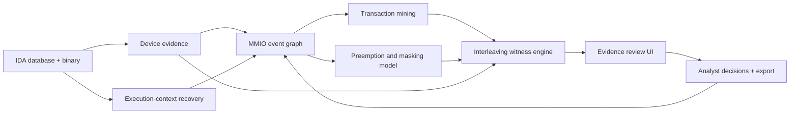

# IRQScope: Product and Technical Architecture

## 1. Product thesis

IRQScope is a **peripheral concurrency forensics workbench** for firmware analysts. It reconstructs enough of a firmware's device-facing execution model to find and explain potential transaction corruption caused by interrupts.

The hard problem is not detecting two accesses to one address. It is determining whether those accesses belong to the same peripheral operation, whether one context can preempt the other at that point, whether register operations have side effects or commute, and what evidence supports each inference.

The project's differentiator is therefore the **Interleaving Witness Engine**: translate incomplete binary evidence into a short, path-linked candidate schedule that the analyst can audit and refine.

## 2. Scope and honest novelty

PASan already detects peripheral-access concurrency bugs for bare-metal applications from source-level inputs and explicitly discusses the challenges of applying its method to stripped binaries. IRQScope must not claim to invent peripheral concurrency analysis. Its contribution is a binary-first workflow integrated with IDA: interactive vector/context recovery, microcode-backed access recovery, device semantics, preemption reasoning, witness navigation, and analyst-maintained evidence.

IEmu and other firmware emulation work also address interrupt modeling. IRQScope is complementary: static recovery and evidence-first review are the core; emulation or device execution is not required for the initial release.

## 3. Threat and analysis model

### Supported first target

- ARM Cortex-M Thumb firmware, initially one image and one address space.
- Bare-metal images first. RTOS task contexts are a later, separately validated extension.
- Optional CMSIS-SVD device description. Manual memory-region and register annotations are supported where no SVD exists.
- Hex-Rays microcode when available; a reduced instruction-level mode can still map direct references and present device/context evidence without pretending to provide full dataflow precision.

### Assumptions surfaced to the analyst

- A vector table may be relocated or reconstructed incompletely.
- A stripped binary may not preserve useful symbols or function boundaries.
- MMIO ranges can be aliased, derived indirectly, or accessed through helper functions.
- Peripheral transaction boundaries often are not explicit in machine code.
- A static call graph does not prove runtime reachability or hardware event order.
- Device side effects and interrupt behavior can be incomplete or wrong in an SVD.

Every finding carries these uncertainties. The tool distinguishes **observed** (instruction/dataflow evidence), **described** (SVD or analyst model), **inferred** (heuristic recovery), and **assumed** (scenario supplied by analyst).

## 4. Analysis pipeline



### Stage A — Device evidence

1. Parse CMSIS-SVD with the standard XML library. The current reader preserves peripheral, cluster, register, and field inheritance; expands their arrays; imports field positions, access policy, inherited `resetValue`/`resetMask`, register/field range, enum-only, and write-as-read constraints, `readAction`, `modifiedWriteValues`, and named enumerated-value sets, including `read`/`write` usage and wildcard bit patterns; and retains validated `alternatePeripheral`, `alternateCluster`, and `alternateRegister` links. Full schema validation, use of reset state and write constraints in abstract analysis, and manual address overrides remain future work.
2. Let analysts add, correct, or alias register regions in the UI. Never replace manual knowledge with an inferred label without showing provenance.
3. Scan for absolute MMIO references and common literal-pool / pointer-construction patterns. Build a provenance chain from instruction to constant to effective address. The current scaffold uses bounded 32-bit disassembly-level propagation for moves, literals, add/subtract/reverse-subtract/negate, MVN, bitwise operations with known rendered operands, UBFX/SBFX/BFI/BFC, and standalone LSL/LSR/ASR/ROR instructions, then resolves base-plus-displacement and constant-index LSL flows. It also prunes constant CBZ/CBNZ edges and derives common ARM conditions after CMP/CMN/ADDS/SUBS or zero/sign conditions after TST/TEQ when operands are known, including supported constant shifted-register forms. Predicated compares, Thumb IT blocks, other flag predicates, carry-dependent RRX forms, dynamic indices, and unsupported forms are left unresolved. A future microcode adapter should improve coverage and provenance.
4. Keep unmapped accesses as candidates with confidence and reason. Do not auto-label all high addresses as hardware.

### Stage B — Execution-context recovery

1. Detect candidate Cortex-M vector tables using initial stack plausibility, reset-vector executable mapping, alignment, and a plausible run of handler pointers. Require confirmation when candidates compete.
2. Associate exception slots with function entries; annotate default handlers and shared handlers separately.
3. Recover calls to NVIC enable/disable/clear-pending/priority interfaces and direct system-control-register accesses where recognized.
4. Track known mask state through PRIMASK, BASEPRI, FAULTMASK, common CMSIS intrinsics, and instruction idioms. Join save/restore paths and identify imbalanced mask windows.
5. Build a preemption relation rather than a flat list of ISR functions: a handler can preempt another only where the vector mapping, priority ordering, enabled state, and active mask state permit it. Unknown priority or dynamic enable becomes `possible` with a visible reason.

### Stage C — MMIO event graph

Each event records:

```text
EA, function, basic block, path guard, read/write, width,
resolved address, peripheral/register/field, value abstraction,
source of address evidence, SVD/manual semantics, confidence
```

Use microcode for normalized loads/stores, constant propagation, masks, and selected def-use chains. Hex-Rays documents microcode as the decompiler's processor-independent representation and exposes generation hooks; this provides a practical analysis layer while retaining instruction EAs for navigation. Microcode support remains optional: the plugin must degrade clearly if the decompiler is unavailable.

Track value classes, not arbitrary symbolic expressions: constants, known bit masks, pointer bases plus offsets, finite intervals, and unknown. Apply configurable caps on path length, loop unrolling, and state count. When a cap is reached, emit an explicit truncation note.

### Stage D — Transaction mining

The current prototype implements a deliberately smaller first slice: it proposes up to five foreground MMIO events per chain by following recovered CFG reachability between event pairs, including loop-backs and repeated instruction events. The CFG filters known-constant CBZ/CBNZ and derives common ARM flag conditions from immediately preceding CMP/CMN/ADDS/SUBS or zero/sign from TST/TEQ when operands resolve through the bounded constant resolver, including supported shifted-register forms. It surfaces repeated register/operation patterns, event addresses, paths, and limitations in the dashboard and JSON. These are analyst-review leads only; the miner does not recover other branch predicates, establish a whole-path feasible schedule, or validate protocol invariants.

Mine candidate operation automata from:

- repeated ordered accesses within a function or strongly connected component;
- status polling followed by data/control access;
- data/status handshake patterns;
- call boundaries around peripheral helper routines;
- SVD-described side effects and field dependencies;
- analyst-marked begin/end events and named patterns.

Represent each candidate as states and event transitions with basic-block path predicates. Preserve multiple alternatives rather than merging incompatible paths. Each edge is tagged `binary-observed`, `SVD-derived`, `signature-derived`, or `analyst-confirmed`.

The system reports transaction candidates, not ground truth, until validated. The reviewer can split, merge, rename, or reject candidates; decisions are persisted in the analysis project.

### Stage E — Conflict and interleaving analysis

Two events conflict when their effects may not commute under the selected peripheral model. Examples:

- SVD read-to-clear status read overlapping a foreground status check;
- full-word assignment to an ordinary writable register where two exact constants produce different final bits;
- write-one-to-clear or toggle side effects overlapping an update;
- shared control-register read-modify-write where masks overlap or cannot be resolved;
- data-register reads/writes crossing an active operation boundary;
- handler event sequence advancing a peripheral automaton during a foreground operation;
- shared DMA buffer ownership or completion state, when an analyst-defined DMA model exists.

The long-term engine should use a small, explicit abstract transition system. A state contains the current CFG location for each software context, abstract interrupt enable/priority/mask state, and the tracked peripheral automaton state. A transition is either one firmware event or an eligible interrupt entry. For a candidate foreground transaction, bounded exploration asks whether any allowed schedule reaches a configured bad state or violates an operation invariant. The short schedule is the witness.

Do not infer bad states from access overlap alone. A peripheral contract must supply the invariant, such as “a completion indication remains observable until acknowledged” or “the command and payload registers are consumed as one operation.” Contracts can come from analyst-authored rules, an explicitly selected device-model pack, or a manually confirmed inference. Without a contract, report an access conflict candidate rather than a protocol violation.

The scheduler enumerates only permitted preemptions. It asks whether a higher-priority/enabled context can enter a foreground path at each event boundary, applies mask state, then searches for the shortest conflict witness. It produces a candidate schedule with path conditions and assumptions, not a proof of real hardware behavior.

For scalability, use bounded exploration with partial-order reduction: independent events are not permuted, only conflicting events and interrupt edges are explored. Cache per-function summaries and invalidate them only when relevant database ranges, SVD annotations, or analyst decisions change.

### Finding strength ladder

1. **Shared access** — two recovered contexts touch one register; weakest triage signal.
2. **Semantic conflict** — SVD or analyst model describes a non-commuting register operation.
3. **Feasible interleaving** — concrete CFG paths and a modeled preemption edge produce a witness under recorded assumptions.
4. **Contract violation** — a confirmed peripheral automaton plus bounded schedule reaches a bad state.
5. **Trace corroborated** — an imported execution trace matches the predicted sequence; this supports, but does not prove, generality.

The UI labels the level and shows why a result did not reach the next level. No probability percentage is displayed unless calibrated against a released, versioned benchmark.

### Stage F — Validation and counterfactual review

- **Review verdicts:** confirmed, false positive, requires device documentation, or not enough binary evidence.
- **Assumption toggles:** change an SVD side effect, interrupt priority, enable state, transaction boundary, or external-actor model and recompute affected witnesses.
- **Mask coverage lens:** highlight code where `PRIMASK`/`BASEPRI`/priority filtering does or does not exclude the conflicting handler.
- **Counterfactual guard check:** annotate a proposed critical section or lock boundary and show which witnesses disappear, persist, or move to a higher-priority handler. This is analysis only; never patch the binary automatically.
- **Evidence export:** Markdown for review; JSON for machine processing; optional SARIF only after locations map cleanly to SARIF semantics.

## 5. Finding catalog

Each finding has a unique stable ID, severity rationale, affected peripheral, two or more context paths, conflict explanation, witness schedule, confidence vector, assumptions, and review state.

Initial high-value patterns:

1. **Destructive status race** — read-to-clear/modify status access in one context can invalidate a check in another.
2. **Register update lost-write** — overlapping read-modify-write windows can erase fields written by another context.
3. **Transaction splice** — handler access can occur between protocol phases that are inferred to form one foreground operation.
4. **Uncovered critical section** — code masks configurable interrupts, but an NMI/fault or higher priority configured context remains eligible; reported only when architecture details are known.
5. **Unbalanced mask path** — a feasible path exits with a mask state different from entry or restores a stale state.
6. **DMA ownership ambiguity** — CPU and interrupt-visible access overlaps a buffer that an analyst-configured DMA transfer can own; lower confidence until transfer semantics are confirmed.
7. **Vector/handler uncertainty** — not a bug finding; a coverage warning that affected conclusions may be incomplete.

Severity is about consequence potential, while confidence is evidence quality. They must never be collapsed into one opaque score.

## 6. The interface

### Overview dock

Header: target CPU, image, chosen SVD, analysis freshness, and explicit unknown counts. Main panes:

- **Context graph:** foreground and ISR lanes; edges show possible preemption and the evidence for it.
- **Peripheral map:** register groups sized by access activity; color marks read/write/side-effect/unknown. It is a navigation aid, not a heatmap-only result.
- **Findings list:** filters by peripheral, conflict class, confidence, context pair, and review status.
- **Witness timeline:** alternating context lanes show exact ordered events; selecting an event syncs disassembly, pseudocode, and xrefs.
- **Evidence inspector:** provenance for each inference and a one-click “why unknown?” explanation.

### Interaction details that make the tool feel finished

- Import wizard with SVD preview, address-base relocation, vector-table candidate review, and clear conflict messages.
- Empty state with a three-step path: choose SVD or manual map, confirm vector table, run first analysis.
- Progressive analysis status, cancellation, and partial results on large firmware.
- Stale-analysis banner when database changes invalidate an event or witness.
- Keyboard-first triage, bulk verdicts, bookmarks, and IDA-native navigation.
- Theme-aware contrast and restrained color palette; severity uses shape/icon plus color.
- No AI chat panel. If later added, AI may summarize an existing proof object but cannot generate or upgrade findings.

## 7. Data model and persistence

Core immutable records:

- `DeviceModel`: peripherals, address ranges, registers, fields, access and side effects, provenance.
- `ExecutionContext`: thread/handler identity, vector slot, priority abstraction, enable/mask state.
- `MMIOEvent`: instruction EA, effective address expression, operation, width, value abstraction, CFG location.
- `PathSummary`: entry/exit abstract states, event sequence, guards, unknown/truncated facts.
- `TransactionAutomaton`: candidate states/edges and provenance for each boundary.
- `PreemptionEdge`: source context, interrupted context, relevant PC interval, enabling/mask proof.
- `Witness`: path fragments, schedule, conflict rule, confidence vector, assumptions.
- `TriageRecord`: verdict, note, author-local timestamp, model revision.

Persist analyst verdicts and notes in the `$ irqscope.review.v1` IDB netnode with schema versioning; include current finding reviews in the versioned JSON evidence export. Analyst-authored transaction/interference contracts can currently be imported from bounded JSON, matched against recovered CFG-reachable register events, and embedded with their hash and matched event EAs in the evidence export. A bounded sequence miner now suggests short event chains and includes paths, supporting functions, rationale, limitations, and IDB-persisted analyst decisions scoped to the binary, SVD, and proposal identity in evidence-v15. Cached analysis results are disposable. Validated transaction mining, import/export of review bundles across IDBs, persistent manual device models, and path-predicate-aware contract checking remain planned.

## 8. Confidence and soundness contract

Show a confidence vector, not a single pseudo-precise percentage:

| Dimension | Example evidence |
|---|---|
| Address | exact SVD/base+offset; computed pointer; heuristic candidate |
| Context | vector entry; function name heuristic; analyst-assigned |
| Preemption | priority/mask proven; enabled state inferred; unknown dynamic state |
| Transaction | explicit analyst boundary; repeated path motif; weak sequence guess |
| Semantics | SVD field semantics; vendor manual note; unknown side effect |
| Feasibility | concrete CFG path; bounded over-approximation; truncated search |

No severity/confidence conflation. Every result states whether it is a concrete CFG path in the current IDB, an over-approximation, or a truncated candidate. This is essential because prior research describes binary lifting and interrupt identity/mask handling as material challenges.

## 9. Architecture and implementation choices

- **IDA integration:** Python plugin for rapid iteration, IDA 9.5 target, optional Hex-Rays microcode adapter. Keep all calls into IDA on its UI/main thread unless the SDK explicitly supports safe background use; snapshot data before expensive pure-Python analysis. Runtime compatibility remains unverified until exercised in the host.
- **Core engine:** pure Python records and algorithms independent from IDA modules. This makes fixtures and future standalone analysis possible.
- **UI:** IDA-native dockable widgets and custom viewers. Avoid a webview dependency for the contest build.
- **SVD:** standard-library XML parser; no network fetch or automatic download of vendor packs. Users choose a local file and remain responsible for its license.
- **Persistence:** IDB-local netnode plus versioned portable JSON export.
- **Packaging:** official `ida-plugin.json`, self-contained source, README, example binaries built from authored toy firmware or permissively licensed fixtures, and versioned install ZIP.

## 10. Security and trust boundaries

- Treat SVD, trace imports, and project JSON as untrusted input; cap XML depth/size, event counts, and recursion/state exploration.
- Never execute firmware or vendor scripts during analysis.
- Reject path traversal and unsafe archive extraction if a packaged project importer is added.
- Do not send binaries, device models, or analysis results to any service.
- Show parser errors with file/line context and keep IDB state unchanged on failed import.
- Avoid auto-renaming or patching firmware without explicit analyst actions.

## 11. Evaluation design

The release should ship with a transparent corpus and results table, not just a video:

- Authored Cortex-M fixtures with known safe and unsafe interleavings; symbols retained in source, then stripped for the analysis sample.
- Pairs covering read-to-clear, W1C, read-modify-write, masked and unmasked priorities, balanced/unbalanced mask paths, loops, helper functions, aliases, and false-positive lookalikes.
- Every fixture labels expected result, required assumptions, and whether the engine should find or abstain.
- Metrics: per-pattern recall, false positives per firmware, unresolved-address rate, handler coverage, witness validity, time/memory, and analyst correction count.
- Include at least one real, redistributable firmware sample only after license review; never imply a synthetic corpus predicts field prevalence.
- Add a reproducibility command and record IDA version, processor module, SVD hash, analysis settings, and project revision with each result.

The core quality goal is not maximal alert count. It is a short, inspectable witness with enough evidence to reproduce the reasoning.

## 12. Risks and mitigations

| Risk | Design response |
|---|---|
| MMIO access recovery is brittle in stripped images | Provenance-aware address recovery; manual annotation; unresolved bucket; confidence dimension |
| Transaction boundaries are implicit | Mine candidates, show alternatives, permit review; never assert inferred boundary as fact |
| Dynamic priorities/enables make preemption hard | Three-valued possible/impossible/unknown model; conservative witness assumptions |
| SVD errors yield convincing false reports | SVD source displayed; allow override; separate binary evidence from device semantics |
| Path explosion | Bounded exploration, partial-order reduction, summaries, caching, visible truncation |
| Scope exceeds contest window | Ship the Cortex-M core; defer RTOS, DMA semantics, trace imports, automated device model learning |
| Existing research overlap | Cite PASan/IEmu honestly; differentiate on binary-first IDA evidence workflow and reviewer-controlled uncertainty |

## Sources

- [Hex-Rays Plugin Contest](https://hex-rays.com/plugin-contest)
- [Hex-Rays IDAPython microcode reference](https://python.docs.hex-rays.com/ida_hexrays/index.html)
- [Hex-Rays plugin packaging format](https://hcli.docs.hex-rays.com/reference/plugin-packaging-and-format/)
- [CMSIS-SVD register specification](https://open-cmsis-pack.github.io/svd-spec/main/elem_registers.html)
- [PASan, USENIX Security 2021](https://www.usenix.org/system/files/sec21fall-kim.pdf)
- [IEmu: Interrupt Modeling from the Logic Hidden in Firmware](https://www.sciencedirect.com/science/article/pii/S1383762124001747)
- [CMSIS Core register access](https://arm-software.github.io/CMSIS_6/latest/Core/group__Core__Register__gr.html)
